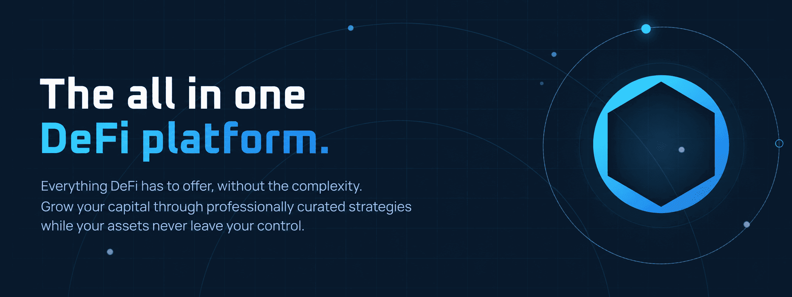
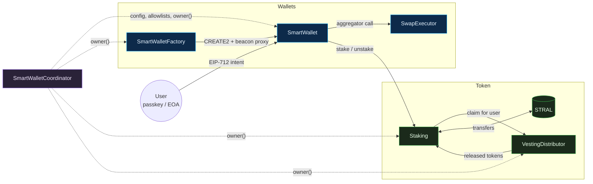

<p align="center">
  
</p>

<h1 align="center">Destral Contracts</h1>

<p align="center">
  <b>The on-chain core of the Destral platform.</b><br>
  The STRAL token, its vesting and staking, and passkey-secured smart wallets that swap, stake and invest without ever leaving the user's control.
</p>

<p align="center">
  <a href="https://docs.soliditylang.org/en/v0.8.24/"></a>
  <a href="https://book.getfoundry.sh/"></a>
  <a href="https://arbiscan.io"></a>
  <a href="https://etherscan.io"></a>
  <a href="LICENSE"></a>
</p>

<p align="center">
  <a href="#-at-a-glance">At a glance</a> ·
  <a href="#-architecture">Architecture</a> ·
  <a href="#-contracts">Contracts</a> ·
  <a href="#-deployments">Deployments</a> ·
  <a href="#-build">Build</a>
</p>

<br>

## ✨ At a glance

<table>
  <tr>
    <td width="50%" valign="top">
      <h3>🔐 Passkey-native wallets</h3>
      Every user gets a smart contract wallet they unlock with a WebAuthn passkey (ES256 or RS256) or a classic EOA signature, verified fully on chain. Several owners can share one wallet with equal rights.
    </td>
    <td width="50%" valign="top">
      <h3>📍 One address, every chain</h3>
      Wallets are created with <code>CREATE2</code> behind a shared beacon, so a user's address depends only on their id and is identical on Arbitrum One and Ethereum. One beacon upgrade moves every wallet at once.
    </td>
  </tr>
  <tr>
    <td width="50%" valign="top">
      <h3>🪙 Token, vesting, staking</h3>
      STRAL is a plain ERC-20 with permit. Sale allocations are preloaded into the vesting distributor and released month by month, straight into time-locked staking positions. Users talk to a single contract for every claim.
    </td>
    <td width="50%" valign="top">
      <h3>🔁 Guarded swaps</h3>
      Wallets swap through DEX aggregators from a signed intent (tokens, amounts, minimum output). The route itself is never signed, so it can be re-quoted freely, while the aggregator call runs in an isolated executor that can only touch the funds committed to that swap.
    </td>
  </tr>
</table>

<br>

## 🏗 Architecture



The **coordinator** is the single source of truth: the strategy address, the token allowlist, the swap wiring and, above all, the `owner()` every other contract defers to for admin checks. Upgradeable contracts sit behind transparent proxies, and all wallets share one upgradeable beacon.

<br>

## 📜 Contracts

### Token

| Contract | What it does |
| :-- | :-- |
| [`StralToken`](src/token/StralToken.sol) | ERC-20 with ERC-2612 permit. Fixed supply, minted to the treasury in the constructor. |

### Vesting and staking

| Contract | What it does |
| :-- | :-- |
| [`VestingDistributor`](src/staking/VestingDistributor.sol) | Holds preloaded vesting positions and releases tokens on a shared calendar of 40 month-end timestamps. Schedules use linear or explicit monthly unlock curves, with an optional cliff. |
| [`Staking`](src/staking/Staking.sol) | Direct time-locked deposits, and the single gateway for withdrawals, vesting claims and combined account reads. |
| [`IVestingDistributor`](src/interfaces/IVestingDistributor.sol) · [`IStaking`](src/interfaces/IStaking.sol) | Interfaces consumed by the staking contract and the wallets. |

### Smart wallets

| Contract | What it does |
| :-- | :-- |
| [`SmartWallet`](src/smartWallet/SmartWallet.sol) | The user's wallet: multi-signer authentication, recipient whitelist for withdrawals, transfers to the strategy, staking and swaps. Deployed as a beacon proxy. |
| [`SmartWalletFactory`](src/smartWallet/SmartWalletFactory.sol) | Deploys wallets at deterministic addresses with CREATE2 and beacon proxies. |
| [`SmartWalletCoordinator`](src/smartWallet/SmartWalletCoordinator.sol) | System-wide configuration and the admin identity every contract defers to. |
| [`MultiSignerAuth`](src/module/MultiSignerAuth.sol) | Authentication module: EOA wallets, ES256 passkeys and RS256 passkeys share equal rights behind EIP-712 typed data signing. |
| [`PasskeySignature`](src/libs/PasskeySignature.sol) · [`RSA`](src/libs/RSA.sol) | WebAuthn assertion verification (ES256 and RS256) against an EIP-712 digest, including PKCS#1 v1.5 RSA with SHA-256. |
| [`SmartWalletRecovery`](src/smartWallet/SmartWalletRecovery.sol) | Temporary wallet implementation letting the coordinator owner register a new owner on a wallet whose owner lost every credential, within a single multisig transaction. |
| [`ISmartWalletCoordinator`](src/interfaces/ISmartWalletCoordinator.sol) · [`ISmartWalletFactory`](src/interfaces/ISmartWalletFactory.sol) | Interfaces of the coordinator and of the factory's parameters callback. |

### Swaps

| Contract | What it does |
| :-- | :-- |
| [`SwapModule`](src/swap/SwapModule.sol) | Stateless module inherited by `SmartWallet`. The user signs the intent, the relayer supplies the aggregator route, and the coordinator allowlist plus `minAmountOut` bound what any route can do. |
| [`SwapExecutor`](src/swap/SwapExecutor.sol) | Shared periphery that performs the aggregator call on behalf of wallets, so a malicious or buggy route can only reach the funds committed to that swap. |
| [`ISwapExecutor`](src/interfaces/ISwapExecutor.sol) · [`IWETH`](src/interfaces/IWETH.sol) | Executor interface and the minimal WETH interface used to wrap native ETH. |

<br>

## 🚀 Deployments

Full records with ABIs, constructor arguments and transaction hashes are published in the `deployments` folder. Proxy addresses are the ones to interact with; implementations are listed for verification.

<!-- deployments:start -->
| Contract | Arbitrum One | Ethereum |
| --- | --- | --- |
| StralToken |  | [`0xDE57A152d893205B175f7E61C472C3dfa000b600`](https://etherscan.io/address/0xDE57A152d893205B175f7E61C472C3dfa000b600) |
| VestingDistributor |  | [`0x481A4dF9ABd7481c3768AEF02e548D35C9bF6B64`](https://etherscan.io/address/0x481A4dF9ABd7481c3768AEF02e548D35C9bF6B64) |
| Staking |  | [`0x06ee574f5d2Da105777Eed6D2Ee47fA61A7D4B97`](https://etherscan.io/address/0x06ee574f5d2Da105777Eed6D2Ee47fA61A7D4B97) |
| SmartWalletCoordinator | [`0xa77216a9F8D2cA6435835a892dc6cf3043dc9647`](https://arbiscan.io/address/0xa77216a9F8D2cA6435835a892dc6cf3043dc9647) | [`0xa77216a9F8D2cA6435835a892dc6cf3043dc9647`](https://etherscan.io/address/0xa77216a9F8D2cA6435835a892dc6cf3043dc9647) |
| SmartWalletFactory | [`0xb4494F642F1a93B8cD11Dc4C5288511feC713080`](https://arbiscan.io/address/0xb4494F642F1a93B8cD11Dc4C5288511feC713080) | [`0xb4494F642F1a93B8cD11Dc4C5288511feC713080`](https://etherscan.io/address/0xb4494F642F1a93B8cD11Dc4C5288511feC713080) |
| SmartWallet_Implementation | [`0x593daA8C8CfDDc045b984735A6f08323CE1B489B`](https://arbiscan.io/address/0x593daA8C8CfDDc045b984735A6f08323CE1B489B) | [`0x593daA8C8CfDDc045b984735A6f08323CE1B489B`](https://etherscan.io/address/0x593daA8C8CfDDc045b984735A6f08323CE1B489B) |
| DefaultProxyAdmin | [`0xCC35133d0c4dCC7E9c91032e12e7B05972AEcAE4`](https://arbiscan.io/address/0xCC35133d0c4dCC7E9c91032e12e7B05972AEcAE4) | [`0xCC35133d0c4dCC7E9c91032e12e7B05972AEcAE4`](https://etherscan.io/address/0xCC35133d0c4dCC7E9c91032e12e7B05972AEcAE4) |
| SmartWalletCoordinator_Implementation | [`0x91B25836c91742EbA9a7AE1D37260681441296b8`](https://arbiscan.io/address/0x91B25836c91742EbA9a7AE1D37260681441296b8) | [`0x91B25836c91742EbA9a7AE1D37260681441296b8`](https://etherscan.io/address/0x91B25836c91742EbA9a7AE1D37260681441296b8) |
| SmartWalletFactory_Implementation | [`0x940ab903Dabb9d36d74B1eC76b26fB547d033BaF`](https://arbiscan.io/address/0x940ab903Dabb9d36d74B1eC76b26fB547d033BaF) | [`0x940ab903Dabb9d36d74B1eC76b26fB547d033BaF`](https://etherscan.io/address/0x940ab903Dabb9d36d74B1eC76b26fB547d033BaF) |
| Staking_Implementation |  | [`0x4698DAeD07caDbEF5535759cF9de4C469556B9a7`](https://etherscan.io/address/0x4698DAeD07caDbEF5535759cF9de4C469556B9a7) |
| VestingDistributor_Implementation |  | [`0x1F7F812b587d6F5658749f7b78f6219649BFdd82`](https://etherscan.io/address/0x1F7F812b587d6F5658749f7b78f6219649BFdd82) |
<!-- deployments:end -->

<br>

## 🛠 Build and test

Solidity `0.8.24`, EVM `cancun`. Foundry project, with `forge-std` vendored under `foundry/lib`.

```bash
npm install   # OpenZeppelin dependencies
forge build
forge test
```

```
src/
├── token/        STRAL token
├── staking/      vesting distributor and staking
├── smartWallet/  wallet, factory, coordinator, recovery
├── swap/         swap module and executor
├── module/       multi-signer authentication
├── libs/         passkey and RSA signature verification
└── interfaces/
tests/
├── unit/         one suite per contract, adversarial cases included
├── scenarios/    end-to-end flows across contracts
├── invariant/    stateful fuzzing of the wallet, factory, swap and vesting invariants
└── fixtures/     mocks and shared test bases
```

<br>

## 📄 License

Released under the [Apache License 2.0](LICENSE).
